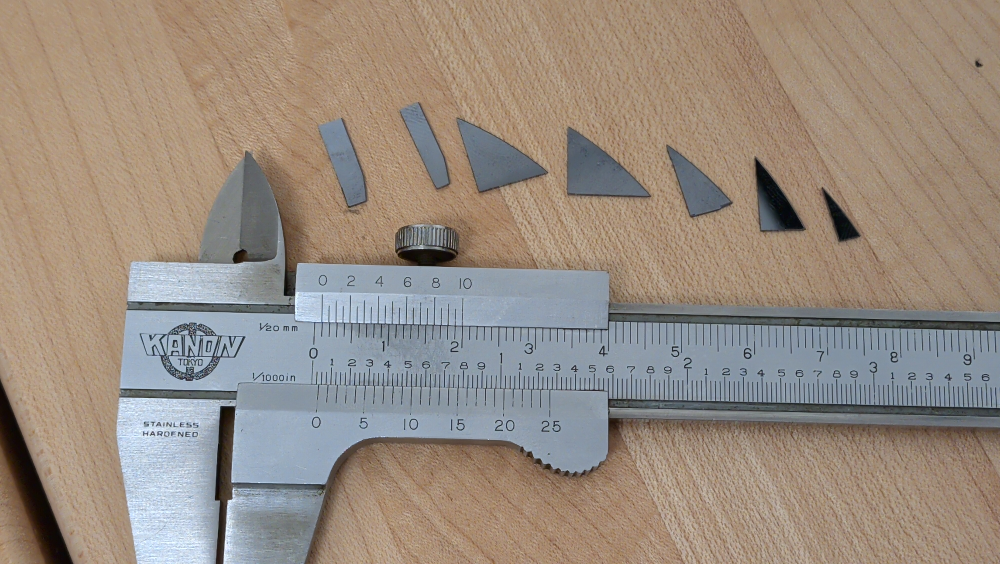
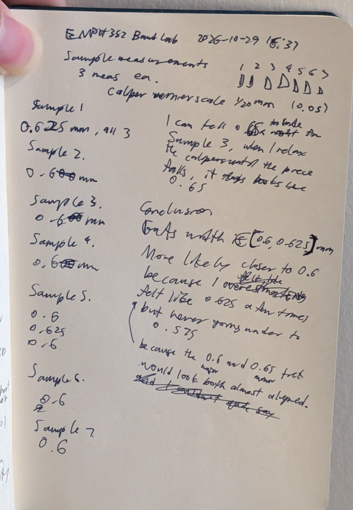

# Band Logbook

## 2026-11-09 Data Processing
> Goal: Try fitting the Urbach Edge to the collected absorbance data.
> 
> Approach: Notebook.
> 
> Questions: _

Worksession 11:00-15:07: data from practice run Oct 29 is not well fittable, but the data processing methods are developed. Try on Nov 5 clena run with smoothed reference spectrum and longer integration time -> periodic brightness variation identified on Nov 5 mitigated.

Do data analysis by today, so that I know whether I need to do more data collection on Tuesday's reading break lab time.

Uncertainty analysis note: https://chem.libretexts.org/Bookshelves/Analytical_Chemistry/Supplemental_Modules_(Analytical_Chemistry)/Quantifying_Nature/Accuracy_of_Spectrophotometer_Readings

## 2026-11-05 Lab Session 3
[Lab session 3 logbook](band-lab3-logbook.pdf)

## 2026-10-29 Lab Session 2

> Goal: Take transmission data, plot it to see if it looks like a spread-out absorbance step change.
> 
> Approach: Follow all guidance available from Ocean Optics manual to perform the absorbance measurement. Paper lab manual, Appendix A Experiment Tutorials, Absorbance Experiments.

Lab data condition: lamp set to 60 V (maximum ~117), starting with one 10% ND filter (filter light outside of band, in case that disrupts sensitivity). Lamp turned on at 2:05pm. 

Temperature control started at 14:50. Start measuring the GaAs sample at a temperature of 20°C. The temperature takes at least 5 minutes to stabilize to within 0.5°C. Conduct measurements at temperature intervals of 20°C up to 120°C. 

Rough procedure
0. ~~Set temperature to 20°C.~~ (The room is already at 19.8°C now.)
0. Screw in blank holder.
1. Reference and dark measurement while that's happening.
2. Screw in GaAs sample holder. Wait for temperature to stabilize.
3. Take measurement, save text data, save plot, check reasonable.
4. Turn on the copper block heating.
5. Repeat at higher temperature points.

Question: are the ND filters also collimators?
- ND filter should not affect light focus, it is not lensed. Check the lab paper documents, and look at how they magnify or mirror an image. 
- They don't, they look to be flat filters. Confirm later with the Edmund Optics product listing.

Note: light at 60 V, one 10% ND filter is too bright. Minimum integration time is 3 ms. Cannot go below. Adding one 5% filter. Integration time is now about 35 ms. The measured intensity sees a periodic oscillation. Possibly AC signal. Try to average out by averaging over more samples. Online search suggests true AC coupling into measurement. Possible source: the halogen lamp brightness flickering with the AC power at 60 Hz.

Note: ~~to store the reference and dark spectra, click on the 'No Pre-processor, Absorbance Mode' layer, then File -> Store -> Store Dark Spectrum (Ctrl+D) or Store Reference Spectrum (Ctrl+R).~~ Use the 'save spectrum' icon in the toolbar, which allows you to save the reference, dark, and processed spectra to text file.
 
Note: First absorbance spectrum, absorbance seems to shoot up around 892 nm. 

Note: reference and dark spectra should've been captured with boxcar as well to smooth spectrum. Small random variation between scans will add noise to measurement. Set boxcar = 5 in the next attempt.

Note: Let's try measuring at 40°C, then 60°C, then keep this data for next time.

Note: SpectraSuite allows saving captures periodically. Can use this to automatically gather a LOT of captures to average over.

Note: Temperature rises remarkably quickly to 40°C, about 2 minutes time. Will take some time to stabilize.

Problem: absorbance does not start at zero. The GaAs sample holder seems to block more light than expected. Solution: subtract the baseline from the measurement, or add a level shift parameter to the curve fit. The absorbance is very flat at around 920-950 nm.

20: captured at 19.8°C and time about 15:30. Absorbance blows up at 892 nm.

40: captured at 43°C +- 0.5 and time about 15:40. Absorbance blows up at 900 nm. (the temperature went down while I was taking the measurement, I need to have the temp control dashboard and spectra suite next to each other. Taking a single capture right when I record the temperature will ensure consistency.)

60: captured at 60°C +- 0.1 and time about 15:59. Absorbance blows up at ~905 nm. The temperature control is just so much better now. Maybe the temperature controller has a problem with windup (integral error term)?

End by collecting 25 samples of 60°C data for possible comparison.

> Conclusion: I figured out some refinements to the spectroscopy data collection procedure which I need to incorporate into next week's full data collection. The three big ones are: enable boxcar smoothing with a small window size w=5 while capturing the reference and dark spectra, subtract the baseline absorbance to account for the difference in transmission between the GaAs sample holder and blank holder, and to use. Also, I have the option of saving many captures to file for further analysis. 
> 
> Next Steps: Complete the curve-fit and error analysis, and see if I get a result for the band-gap of GaAs which is consistent with published values. If so, otherwise I need to explain the difference. Then, finalize the procedural details and write myself a data collection procedure for Lab Session 3, which will let me complete all the data collection that I need during the lab time.
> 
> Temperature control started at 14:50. Start measuring the GaAs sample at a temperature of 20°C. The temperature takes at least 5 minutes to stabilize to within 0.5°C. Conduct measurements at temperature intervals of 20°C up to 120°C. 

**TODO**: add picture from notebook of the recorded wafer thickness measurement taken in the last half hour of the lab session:

## 2026-10-22 Lab Session 1

> Objective: Figure out how to use the setup, then complete Task 1 (Preliminary Measurements) which is to confirm that I'm measuring the same absolute transmission vs frequency of the optical filter provided in the lab documents.
>
> Approach: There are two provided manuals, one for the spectrometer which I already read in pdf form while doing the prelab this morning, and one for the 10% 5% and 1% 'Neutral Density Filters' in the setup. The lab document gives a transmission curve versus wavelength for some filter, without any 'filter width', 'center frequency', or 'maximum transmission' number. I think I should ask the professor which filter I'm supposed to measure the transmission of, then I can execute the 'Transmission' measurement procedure in the spectrometer manual.
>
> Questions: About how to use the equipment, and how long the light source and temperature control systems take to settle. And, which filter to use for the task 1 measurement, that the provided transmission vs wavelength curve refers to.

Reference filter response: [task1-filter.PNG](AdaL/2026-10-22-Task1/task1-filter.PNG)

Wires?

* Yellow: thermocouple wire, leading to the 'Optical Source' control box.
* Red and black: power and ground to the heating element, I guess?
* Silver: optical fiber from the back of the copper sample to the spectrometer box.

Control software:

* Sample temperature control: Omega CNi16D program. Very simple, it displays a set temperature field which I can edit, a process temperature field which shows the thermocouple measured temperature, and a Standby/Run mode switch.
* Spectrometer control: Ocean Optics SpectraSuite.

14:41: the process temperature takes about xx seconds to increase from 19.5°C to a set temperature of 25°C after turning on the temperature control. 1min,21.6; 1m30,22.2; 2m,22.8; 2m30,23.1; 3m,23.5.; 3m30,23.9; 4m 24.1; 4,30,24.2; 5m,24.5; 5m30,24.6; 6m,24.7;, 6m30,24.9; 7m,24.95; 8m,25.1; 9m,25.2; 10m,25.35. The process temperature reached the setpoint in 7-8 minutes, then slowly rose above. With a higher setpoint temperature the controller may be more easily able to keep the setpoint due to rapid cooling after the heating element is switched off.

15:30: opened SpectraSuite and found out how to do a transmission measurement. I performed the reference and dark measurement with the 1% neutral density filter. The procedure is:

1. Set up the filter
2. Create a new graph
3. File->New->Transmission Measurement
4. Automatically set the integration time and save the reference measurement.
5. Block the lamp and do the dark measurement. I used the textbook on the table.
6. Done! Now you get a new graph view with Transmission (%) on the y-axis, and I can place a sample in the light path to measure.

The light is not controlled by the Strobe/Lamp Enable checkbox.

Observations when I insert different items before the optical fiber: the 5% and 10% Neutral Density filters have a variable over the band 750 nm to about 900 nm, then roll off to undetectable transmission about 970 nm. The sample holder with a piece of paper blocks most light, but not all. I don't think that it's strictly needed. The square filter with one white-mirrored side and one red-mirrored side is the correct filter and gives a response just like the one in the lab. Because I moved the filters around I need to redo the transmission measurement so that the transmission is correctly scaled. I think,

Moving the 1% neutral density filter slightly scales the transmission. Keep the filter which is present in the reference and dark measurement at the same position. There are pencil markings on the rail, do these indicate the ideal filter positions.

## 'Things to think about'

Q: What spectrum is detected without incoming light (i.e. dark signal)?

A: A small intensity, flat over wavelength. This could be stray light or noise, I would think noise. **TODO: read on noise sources in a spectrometer setup and how to control them.** The spectrometer manual gives CCD noise specs.

Q: With directly incident light, what is the effect of time normalization? What is the effect of averaging over several curves?

A: The Intensity scales with the integration time. The CCD has a saturation limit beyond which it cannot take more counts, so I can reduce the integration time, reduce the lamp brightness, or add the neutral density filters into the light path to lower the intensity.

Paper manual pg. 40 recommends setting integration time so that peak value is 85% of maximum CCD counts, so 3500 counts for a 4096-count maximum spectrometer. The measurement setup wizard indicates that the integration time should be set to get 3480 counts peak during the reference measurement, which is consistent with this note.

Averaging over several curves multiplies the acquisition time but reduces noise in the measured spectrum.

Q: There are 4 icons in the software labelled S, A, T, and I -- explain what they stand for and how you can access the A, T, and I functions.

A: Refer to the spectrometer manual. S, A, T, and I stand for measurement modes Scope, Absorbance, Transmission, and Relative Irradiance. Scope is a direct measurement of Intensity (counts) incident on the detector. Transmission is the fraction of photons making it through the sample (expressed in %). Absorbance is -log10(Transmission). Relative irradiance is a measurement I'm not familiar with but seems to be comparing the emitted spectrum of a light source or fluorescent sample against a reference lamp of known colour temperature -> known spectral power density. Transmission and Absorbance measurement seems to be nearly the same, though Absorbance is a bit closer to the figure that I'm looking for.

Note: for chemical solutions A is proportional to concentration, and. $A = \varepsilon \ell  c$, where $c$ is the chemical concentration in mol/L and $\ell$ is the sample length. The analogy for my sample is to replace $c\varepsilon$ with a single coefficient $\alpha$, and to use base e instead of base 10 for the logarithm.

Note in the paper spectrometer manual pg. 98: If possible, do not turn off the light source when taking a dark spectrum.

**TODO: correct the prelab, I think I misinterpreted the absorbance figure.**

## Filter Measurement Graph

16:33: I crashed the software by trying to print my spectrum.

16:45: Measured spectrum has the right shape, and the peak transmission is about 46% at 800nm instead of about 52% in the reference page. Reasonable, but I need to figure out the intensity discrepancy. Moving the filter doesn't help.

Data and images will be collected on USB and uploaded later.

## Reflection

> Conclusion: Task 1 answered mostly to my satisfaction. I can measure the filter transmission which is similar to the reference plot and understand the SpectraSuite software.
>
> Next steps: I think I know how to use the spectrometer now! Come up with a measurement procedure and data analysis script for Task 2. Use the collected reference counts and sample transmission files as the example data format.
>
> Questions: Is there a right and wrong way to place the optics on the guiderail? e.g. ND filter too close to source or sample? There are pencil markings on the rail, what do they mean?